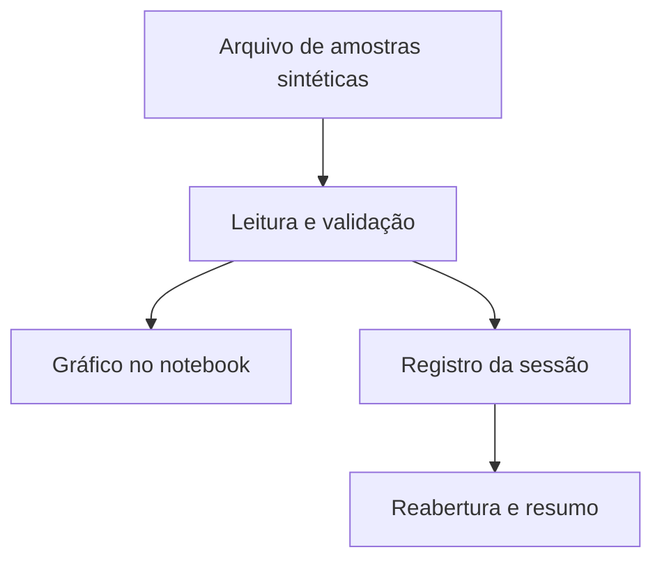

# SVE · Sistema de Voo Embarcado da URASpace

O SVE é o software do computador de bordo dos foguetes da URASpace. O projeto está nas primeiras fases e o primeiro protótipo tem **500 m como meta de apogeu**. Este guia apresenta a instrumentação em nível conceitual e propõe uma atividade de bancada para qualquer integrante acompanhar uma sessão de dados no notebook.

## O que faz cada parte?

| Parte | Pergunta que responde | Exemplo didático |
|---|---|---|
| Sensor | O que foi medido? | Produz uma leitura física. |
| Computador de bordo | Como a leitura vira um registro? | Associa valor, unidade e instante a uma amostra. |
| Registro local | Onde ficam os dados para consulta posterior? | Um registrador armazena as amostras da sessão. |
| Telemetria | Como a leitura chega a outro equipamento? | Um emissor envia dados que um receptor pode entregar ao software de solo. |
| Estação de solo | O que a pessoa vê? | O notebook mostra gráficos, indica quando pararam de chegar dados e permite consultar o histórico. |

**PCB** é a placa de circuito impresso. É a peça física que sustenta e interliga os componentes eletrônicos. **Computador de bordo** é a unidade que processa os dados. **SVE** é o software que roda nessa unidade.

## Como imaginar a eletrônica por dentro?

Em termos funcionais, imagine três blocos: **medição**, **processamento e registro** e **alimentação**. Em uma placa didática, algumas dessas funções podem aparecer lado a lado. A ideia de “andares” ajuda a visualizar a separação de funções, mas a disposição física, o número de placas e o formato do conjunto da URASpace ainda precisam ser confirmados com a equipe.

| Referência visual | O que observar |
|---|---|
| [OpenLog Artemis, SparkFun](https://learn.sparkfun.com/tutorials/openlog-artemis-hookup-guide/hardware-overview) | Fotos da placa e identificação dos componentes de um registrador de bancada. Localize o processamento e as conexões. |
| [Vista do cartão microSD e uso em bancada](https://learn.sparkfun.com/tutorials/openlog-artemis-hookup-guide/hardware-hookup) | Veja onde a placa guarda dados localmente e como a leitura também pode aparecer em um computador conectado por USB. |
| [StarRocket Flight Replay](https://github.com/nidhalom/starrocket-flight-replay) | Exemplo de interface estudantil para visualizar sessões e importar arquivos CSV ou JSON. |

A placa da SparkFun é uma referência publicada de instrumentação. O guia do SVE usa suas fotos para explicar funções da eletrônica. A equipe pode acrescentar fotos próprias, com legenda e versão, quando tiver um protótipo documentado.

## Como um valor de 500 m apareceria no notebook?

A altura é um **dado**. Se a estação receber uma amostra que diga “altitude relativa de 500 m no instante de 8 s”, ela pode apresentar esse ponto no gráfico. Se a entrada parar, o último valor pode permanecer visível com a indicação **dados desatualizados**. A altura prevista de 500 m, por si só, não confirma o alcance nem a disponibilidade de um enlace real.

Para experimentar o fluxo, o arquivo de bancada começa diretamente na entrada da estação, com amostras simuladas.

### Exercício de 5 minutos

1. Abra [a sessão de exemplo](examples/telemetria-sintetica.csv) em uma planilha.
2. Faça um gráfico de dispersão com `tempo_s` no eixo horizontal e `altitude_relativa_m` no vertical.
3. Encontre a maior altitude **registrada**. O resultado esperado é **500 m aos 8 s**, com referência ao zero da sessão sintética.
4. Observe o salto de 8 para 12 s. Se o exercício espera uma amostra a cada 2 s, falta uma leitura aos 10 s. O que ocorreu nesse intervalo permanece desconhecido.
5. Para discutir o painel com a equipe, simule uma pausa na entrada e pergunte como o operador percebe que a última leitura ficou antiga.

## Skills para agentes de IA

Cada `SKILL.md` diz ao agente quando usar aquele roteiro, que entradas pedir e o que entregar. Em uma ferramenta compatível, importe a pasta da skill conforme as instruções da ferramenta. Em um chat comum, anexe o `SKILL.md` e o CSV e peça explicitamente à IA para seguir o roteiro.

| Skill | Responsabilidade | Pedido de exemplo |
|---|---|---|
| [Contrato de dados](skills/sve-contrato-de-dados/SKILL.md) | Definir campos, unidades e referência de tempo e altitude. | “Confira se este CSV serve como exemplo para o painel.” |
| [Estação de solo](skills/sve-estacao-de-solo/SKILL.md) | Demonstrar recepção de amostras sintéticas no notebook, visualização e registro. | “Mostre como o painel indica um dado antigo.” |
| [Testes de bancada](skills/sve-testes-de-bancada/SKILL.md) | Exercitar pausas, lacunas, duplicatas e linhas inválidas. | “Monte uma tabela de testes para este arquivo sintético.” |
| [Replay e análise](skills/sve-replay-e-analise/SKILL.md) | Reabrir arquivos e explicar o pico registrado e os intervalos sem amostra. | “Analise a sessão e aponte os limites da conclusão.” |

## O que vale confirmar com a equipe

- Qual placa ou protótipo a equipe tem hoje e onde estão as fotos ou os registros de bancada?
- Quais grandezas ela já consegue registrar e em que formato?
- Existe algum arquivo de uma sessão de bancada que possa ser aberto por outro integrante?
- Quem mantém o software de bordo e quem ficará responsável pelo painel no notebook?

## Referências universitárias

- [Fênix – Estudos Astronáuticos, UFMG](https://aero.cpdee.ufmg.br/index.php/fenix/) descreve a organização por subsistemas, incluindo aviônica e simulação.
- [Projeto Jupiter, Poli-USP](https://www.poli.usp.br/noticias/polinamidia/equipe-da-poli-usp-fica-em-segundo-lugar-em-competicao-mundial-de-foguetes-universitarios/) apresenta um exemplo brasileiro de equipe de foguetemodelismo universitário.
